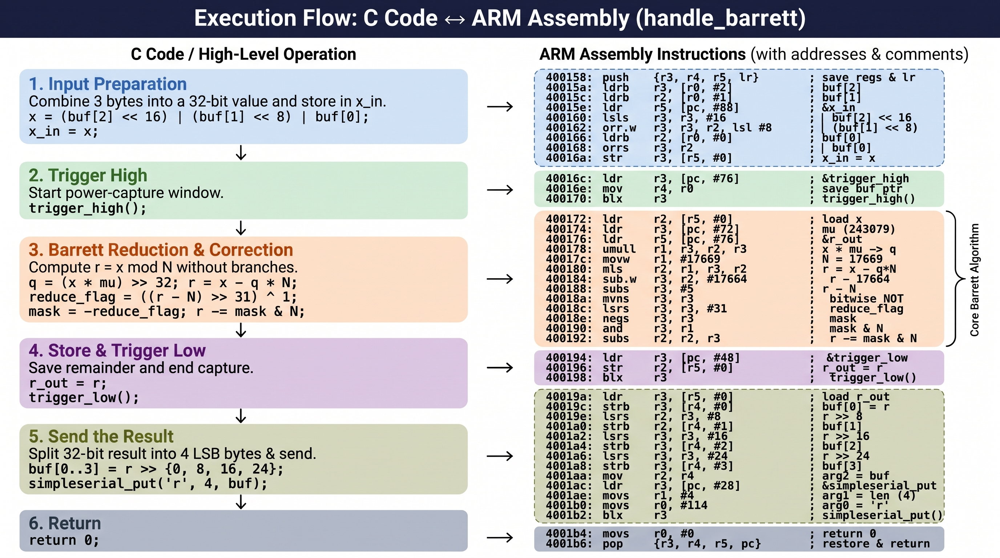

# Understanding `handle_barrett`: C-to-ARM Assembly Mapping

This document explains how `handle_barrett` works, how its ARM instructions map to the C code, and what each group of instructions does.

## 1. The big picture

`handle_barrett` receives a 3-byte input, combines it into a 32-bit value `x`, runs Barrett reduction, stores the result, and sends it back over SimpleSerial.



| Stage             | What happens                                                   |
| ----------------- | -------------------------------------------------------------- |
| Before trigger    | Read the input bytes and assemble `x`                          |
| Trigger HIGH      | Starts the power-capture window                                |
| Barrett reduction | Estimate the quotient, calculate the remainder, and correct it |
| Trigger LOW       | Ends the power-capture window                                  |
| After trigger     | Split the result into bytes and send it                        |

> The trigger marks a measurement window. It does not necessarily align exactly with the first arithmetic instruction.

## 2. A few ARM basics

| Instruction / term | Meaning                                                             |
| ------------------ | ------------------------------------------------------------------- |
| `r0`–`r12`         | General-purpose registers that temporarily hold values or addresses |
| `PC`               | Program Counter; tracks the instruction location                    |
| `LR`               | Link Register; usually holds the return address for a function call |
| `LDR` / `STR`      | Load from memory / store to memory                                  |
| `LDRB` / `STRB`    | Load / store one byte                                               |
| `LSL` / `LSR`      | Shift bits left / right                                             |
| `ORR` / `AND`      | Bitwise OR / AND                                                    |
| `BLX`              | Call a function using an address in a register                      |
| `PUSH` / `POP`     | Save / restore registers                                            |
| `#number`          | An immediate constant, used directly in the instruction             |

Registers are like small, fast storage slots inside the processor. Memory holds variables; registers hold values the processor is currently working with.

## 3. Before the trigger: build the input `x`

The input arrives in `buf` as three bytes. The code combines them into one value:

```c
x = (buf[2] << 16) | (buf[1] << 8) | buf[0];
x_in = x;
```

Assembly:

```asm
400158: push  {r3, r4, r5, lr}
40015a: ldrb  r3, [r0, #2]
40015c: ldrb  r2, [r0, #1]
40015e: ldr   r5, [pc, #88]
400160: lsls  r3, r3, #16
400162: orr.w r3, r3, r2, lsl #8
400166: ldrb  r2, [r0, #0]
400168: orrs  r3, r2
40016a: str   r3, [r5, #0]
```

| Instruction        | What it does                                                       |
| ------------------ | ------------------------------------------------------------------ |
| `push`             | Saves registers that this function will use and the return address |
| `ldrb`             | Reads a byte from `buf`                                            |
| `ldr r5, ...`      | Loads the address of `x_in`                                        |
| `lsls r3, r3, #16` | Moves `buf[2]` into bits 16–23                                     |
| `orr.w ... lsl #8` | Places `buf[1]` into bits 8–15 and combines it with the value      |
| `orrs r3, r2`      | Combines the lowest byte, `buf[0]`                                 |
| `str`              | Stores the assembled `x` in `x_in`                                 |

The shifts position each byte in the correct part of the 32-bit value. OR combines them without overwriting the other bytes.

## 4. Trigger HIGH: begin the capture window

```asm
40016c: ldr   r3, [pc, #76]
40016e: mov   r4, r0
400170: blx   r3
```

- `ldr` loads the address of `trigger_high`.
- `mov r4, r0` saves the buffer address for later use.
- `blx r3` calls `trigger_high()`.

The trigger function sets the trigger pin HIGH. The function call itself has some overhead, so the trigger edge and the first Barrett arithmetic instruction are not necessarily at the same instant.

## 5. Barrett reduction: calculate the approximate remainder

The reduction uses:

- `N = 17669`
- `mu = 243079` (`0x0003b587`)

The core idea is to estimate the quotient `q`, then calculate:

\[
r = x - qN
\]

Assembly:

```asm
400172: ldr   r2, [r5, #0]
400174: ldr   r3, [pc, #72]
400176: ldr   r5, [pc, #76]
400178: umull r1, r3, r2, r3
40017c: movw  r1, #17669
400180: mls   r2, r1, r3, r2
```

| Instruction    | What it does                                                                         |
| -------------- | ------------------------------------------------------------------------------------ |
| `ldr r2, [r5]` | Reads `x` from `x_in`                                                                |
| `ldr r3, ...`  | Loads `mu`                                                                           |
| `ldr r5, ...`  | Loads the address of `r_out`                                                         |
| `umull`        | Multiplies `x` by `mu`, producing a 64-bit result; the upper 32 bits are used as `q` |
| `movw`         | Loads the modulus `N = 17669` into `r1`                                              |
| `mls`          | Computes `r2 = r2 - (r1 × r3)`, i.e. `r = x - qN`                                    |

`UMULL` produces a 64-bit product from two 32-bit inputs. In this code, the high 32 bits are the quotient estimate `q`.

`MLS` (Multiply and Subtract) performs the multiplication and subtraction in one instruction.

## 6. Correction step: subtract `N` if needed

The C logic is:

```c
reduce_flag = ((r - N) >> 31) ^ 1;
mask = -reduce_flag;
r -= mask & N;
```

This checks whether `r` is at least `N`, then subtracts `N` only if necessary—without a conventional conditional branch.

Assembly:

```asm
400184: sub.w r3, r2, #17664
400188: subs  r3, #5
40018a: mvns  r3, r3
40018c: lsrs  r3, r3, #31
40018e: negs  r3, r3
400190: and   r3, r1
400192: subs  r2, r2, r3
```

| Instruction       | What it does                                                                                             |
| ----------------- | -------------------------------------------------------------------------------------------------------- |
| `sub.w`           | Subtracts 17664 from `r`                                                                                 |
| `subs #5`         | Subtracts the remaining 5; together the two instructions calculate `r - N`                               |
| `mvns`            | Flips every bit (bitwise NOT)                                                                            |
| `lsrs #31`        | Extracts the flipped sign bit, producing the 0/1 correction flag under the algorithm's range assumptions |
| `negs`            | Converts the flag: 0 becomes `0x00000000`, 1 becomes `0xFFFFFFFF`                                        |
| `and r3, r1`      | Selects either 0 or `N` using the mask                                                                   |
| `subs r2, r2, r3` | Subtracts the selected value from `r`                                                                    |

### Why `MVNS` is used instead of an explicit `^ 1`

The C expression flips the extracted sign bit with XOR 1. The assembly flips **all** bits with `MVNS`, then `LSRS #31` keeps only the bit we care about—the flipped bit 31.

The two instructions together implement the needed inversion of the extracted sign bit. This relies on the range assumptions of this Barrett implementation.

### How the mask works

| `reduce_flag` | After `NEGS` | `mask & N` |
| ------------: | ------------ | ---------: |
|             0 | `0x00000000` |          0 |
|             1 | `0xFFFFFFFF` |          N |

So the final subtraction is either `r - 0` or `r - N`.

## 7. Store the result and Trigger LOW

```asm
400194: ldr   r3, [pc, #48]
400196: str   r2, [r5, #0]
400198: blx   r3
```

- `ldr` loads the address of `trigger_low`.
- `str` stores the final remainder in `r_out`.
- `blx` calls `trigger_low()`, which sets the trigger pin LOW and ends the capture window.

## 8. After the trigger: send the result

The result is split into four bytes:

```c
buf[0] = r;
buf[1] = r >> 8;
buf[2] = r >> 16;
buf[3] = r >> 24;
simpleserial_put('r', 4, buf);
```

Assembly:

```asm
40019a: ldr   r3, [r5, #0]
40019c: strb  r3, [r4, #0]
40019e: lsrs  r2, r3, #8
4001a0: strb  r2, [r4, #1]
4001a2: lsrs  r3, r3, #16
4001a4: strb  r3, [r4, #2]
4001a6: lsrs  r3, r3, #24
4001a8: strb  r3, [r4, #3]
4001aa: mov   r2, r4
4001ac: ldr   r3, [pc, #28]
4001ae: movs  r1, #4
4001b0: movs  r0, #114
4001b2: blx   r3
```

| Instruction     | What it does                                |
| --------------- | ------------------------------------------- |
| `ldr`           | Reads the final result from `r_out`         |
| `strb`          | Stores one byte of the result into `buf`    |
| `lsrs`          | Shifts the result to position the next byte |
| `mov r2, r4`    | Passes the buffer address                   |
| `ldr`           | Loads the address of `simpleserial_put`     |
| `movs r1, #4`   | Sets the message length to 4 bytes          |
| `movs r0, #114` | Sets the message identifier to ASCII `'r'`  |
| `blx`           | Calls `simpleserial_put('r', 4, buf)`       |

The result is sent least-significant byte first: `buf[0]` contains the lowest byte.

## 9. Return

```asm
4001b4: movs r0, #0
4001b6: pop   {r3, r4, r5, pc}
```

- `movs r0, #0` sets the return value to zero.
- `pop` restores the saved registers. The saved return address is loaded into `pc`, so execution returns to the caller.

## 10. Literal pool: the `.word` entries

At the end of the listing:

```asm
4001b8: .word 0x20000024
4001bc: .word 0x00400691
4001c0: .word 0x0003b587
4001c4: .word 0x20000020
4001c8: .word 0x00400671
4001cc: .word 0x00400491
```

`.word` stores a 32-bit value. These entries are data—not instructions. The compiler places constants and addresses here so instructions such as `LDR [PC, ...]` can load them.

| Address  | Value        | Purpose                    |
| -------- | ------------ | -------------------------- |
| `4001b8` | `0x20000024` | `x_in` address             |
| `4001bc` | `0x00400691` | `trigger_high` address     |
| `4001c0` | `0x0003b587` | `mu`                       |
| `4001c4` | `0x20000020` | `r_out` address            |
| `4001c8` | `0x00400671` | `trigger_low` address      |
| `4001cc` | `0x00400491` | `simpleserial_put` address |
